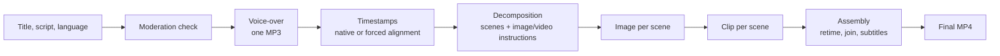
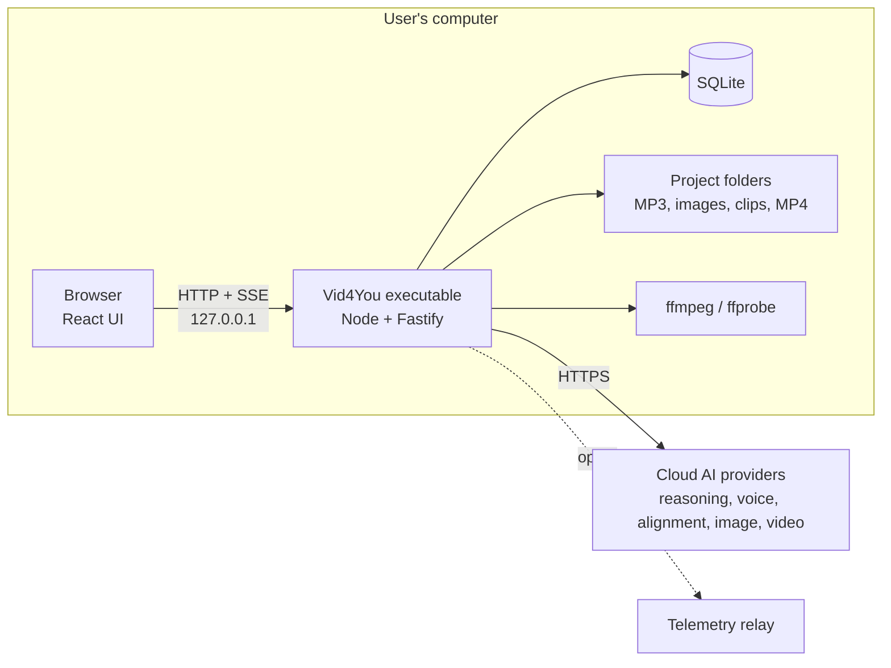

# Vid4You

Vid4You turns a written script into a narrated, horizontal 16:9 MP4 video. The user pastes a title and a script, picks the script's language, and the application narrates it, splits it into scenes, generates an image and a short clip per scene, fits each clip to its stretch of narration and assembles the final video with burned-in subtitles.

It is a single-user application that runs on the user's own computer and calls cloud AI providers for the generation work. The product rules are in [`docs/PRD.md`](docs/PRD.md).

## How it works



1. **Voice-over.** The whole script is narrated once, as a single MP3. The script is locked from this point and is never rewritten.
2. **Timestamps.** Each word is placed in the audio, from the voice provider's own timestamps or, when those are missing or unusable, by aligning the MP3 against the script.
3. **Decomposition.** A reasoning model splits the script into scenes on sentence boundaries, sized to the durations the video provider accepts, and writes an image and a video instruction for each scene. An optional visual style set by the Administrator guides those instructions.
4. **Images and clips.** Each scene gets an image, then a clip animated from that image. Scenes run in parallel, within a per-stage cap on simultaneous provider requests.
5. **Assembly.** ffmpeg retimes each clip to its narration interval, joins the clips in scene order, lays the voice-over as the only audio and burns in one-line subtitles that highlight the word being spoken.

Progress shows live, per phase and per scene. A failed step is retried automatically up to three times, then can be retried by hand, with a corrected image or video instruction if needed; a scene that looks wrong can be rebuilt. The user can pause before the next phase starts, download each image and clip as soon as it exists, and adjust the pause after a scene and rebuild the final video. Everything is kept on disk and survives a restart, including requests already sent to a provider.

Behind a password, `/admin` manages the providers of each stage and their API keys, moves a failed stage to another provider, sets the visual style, tests a provider's connection and shows usage, failure, session, timing, provider-change and estimated-cost reports.

## Architecture



| Part | Technology | Decision |
|---|---|---|
| Backend | TypeScript run natively by Node, Fastify, Zod, OpenAPI generated from the routes | [ADR 0001](docs/adr/0001-backend-stack.md) |
| Persistence | SQLite through `node:sqlite`, plus one folder per project | [ADR 0002](docs/adr/0002-persistence.md) |
| Live updates | Server-Sent Events; a page that reconnects fetches the session's current state again (no replay) | [ADR 0003](docs/adr/0003-live-updates.md) |
| Frontend | React and Vite | [ADR 0004](docs/adr/0004-frontend-stack.md) |
| Media | ffmpeg, bundled with the executable | [ADR 0005](docs/adr/0005-media-assembly.md) |
| Providers | Adapters per stage, chosen and keyed on `/admin`; a configurable connector for video vendors | [ADR 0005](docs/adr/0005-provider-selection.md), [ADR 0009](docs/adr/0009-configurable-video-connector.md) |
| Distribution | One executable per platform (macOS arm64 and x64, Windows x64), listening on loopback only | [ADR 0007](docs/adr/0007-deployment.md) |
| Telemetry | Opt-in OpenTelemetry metrics and errors through a filtering relay; nothing leaves the computer without consent | [`PRIVACY.md`](PRIVACY.md) |

The backend owns the orchestrator: a state machine per session and per scene, a retry policy with a budget per stage, a concurrency cap per stage, and recovery at start-up of anything that was in flight. Every provider is behind a port, so tests run the whole pipeline with stubs.

## Repository

| Path | Contents |
|---|---|
| `backend/` | API, orchestrator, provider adapters, assembly, packaging |
| `frontend/` | User pages and `/admin` |
| `e2e/` | Playwright browser test of the main flow, with stubbed providers |
| `infra/` | Telemetry relay (Cloudflare Worker) and Grafana dashboards and alert |
| `docs/` | PRD, ADRs, data model, API contract, standards, development guide |
| `openspec/specs/` | Behaviour specifications, the source of truth for each capability |

## Running it

Requirements: Node.js 26.4.0, and ffmpeg and ffprobe on the machine for development.

```bash
cd backend && npm ci && npm start      # API on http://127.0.0.1:3100
cd frontend && npm ci && npm run dev   # UI on http://127.0.0.1:5173
```

Provider keys, the Administrator password, settings files, the packaged build and the tests are covered in [`docs/development_guide.md`](docs/development_guide.md).

## Releases

Work merges into `main` through pull requests; merging publishes nothing. A release starts from a version tag on a commit of `main`:

| Tag | Publishes | Channel shown in the app |
|---|---|---|
| `vX.Y.Z-rc.N` | GitHub pre-release | `v1.2.0-rc.1 · uat` |
| `vX.Y.Z` | GitHub release | `v1.2.0` |

- **Publishing.** Push the tag. The Release workflow runs the checks, builds the three executables and waits for approval of the `release` environment: open the run in Actions and choose *Review deployments → Approve*. A rejected or unanswered approval publishes nothing. The release carries the zipped executables and `SHA256SUMS.txt`, and the workflow downloads them again to verify the checksums.
- **Promoting a candidate.** Tag the tested commit `vX.Y.Z`. It is built again, because the version is part of the build.
- **Dry run.** Actions → Release → *Run workflow* builds the executables as workflow artifacts and publishes nothing.
- **Updates.** At start-up the app checks GitHub once and shows a notice when a newer release exists; it never downloads anything. Production builds look only at releases; candidate builds also see newer candidates.
- **Rolling back a bad release.** Delete it with `gh release delete vX.Y.Z --cleanup-tag --yes`, or keep it as a pre-release with `gh release edit vX.Y.Z --prerelease`, which hides it from production builds' update check. The previous release becomes the latest again, and installs of the bad one are offered the previous one as an update. Ship the fix as a new version (for example `v1.2.1`) rather than reusing a tag.

## License

[MIT](LICENSE)
